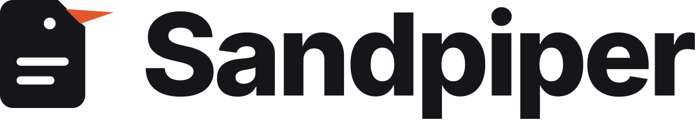
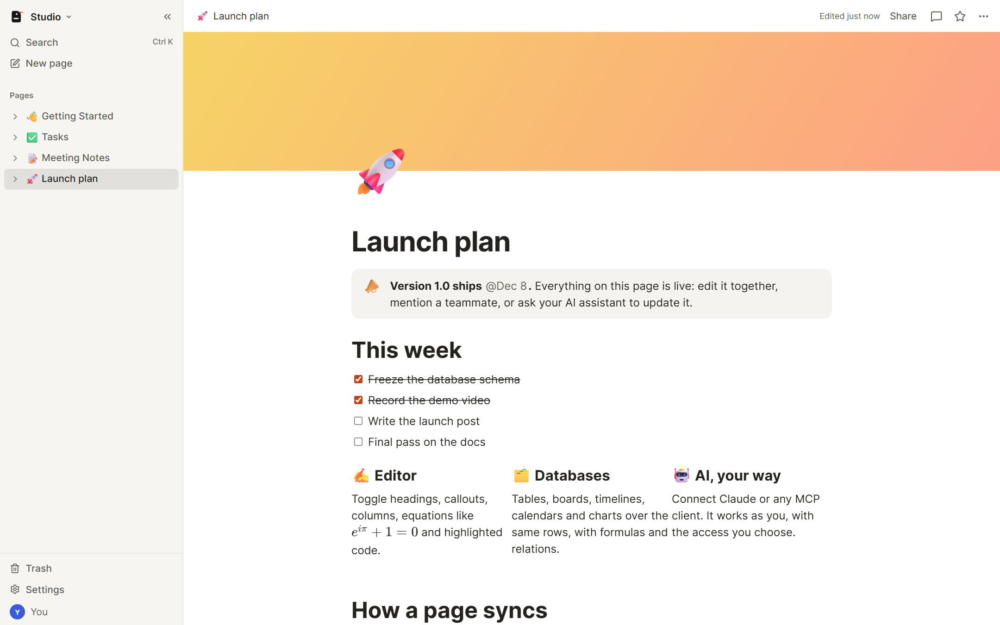
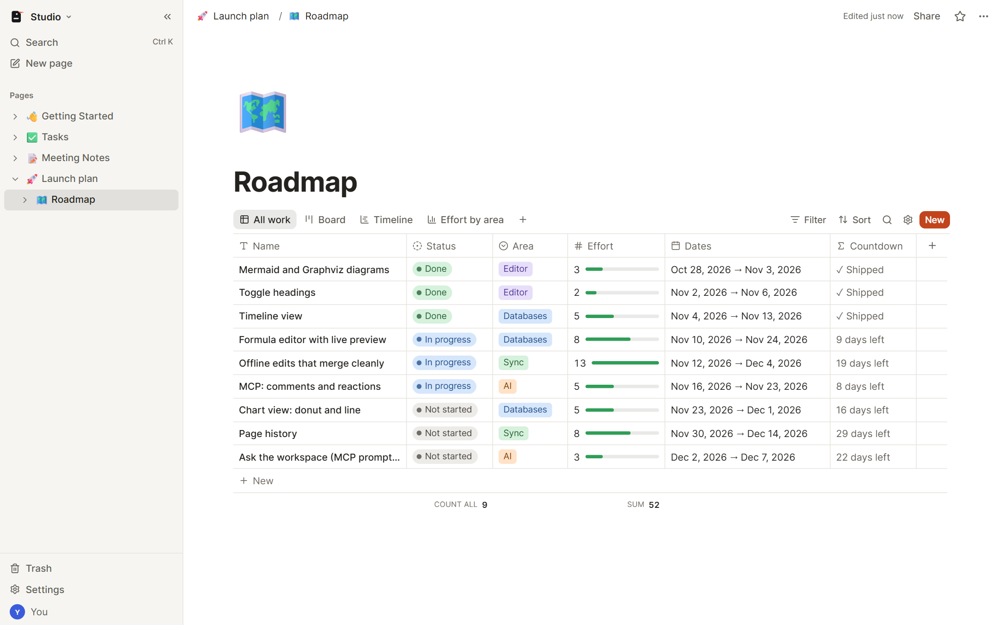
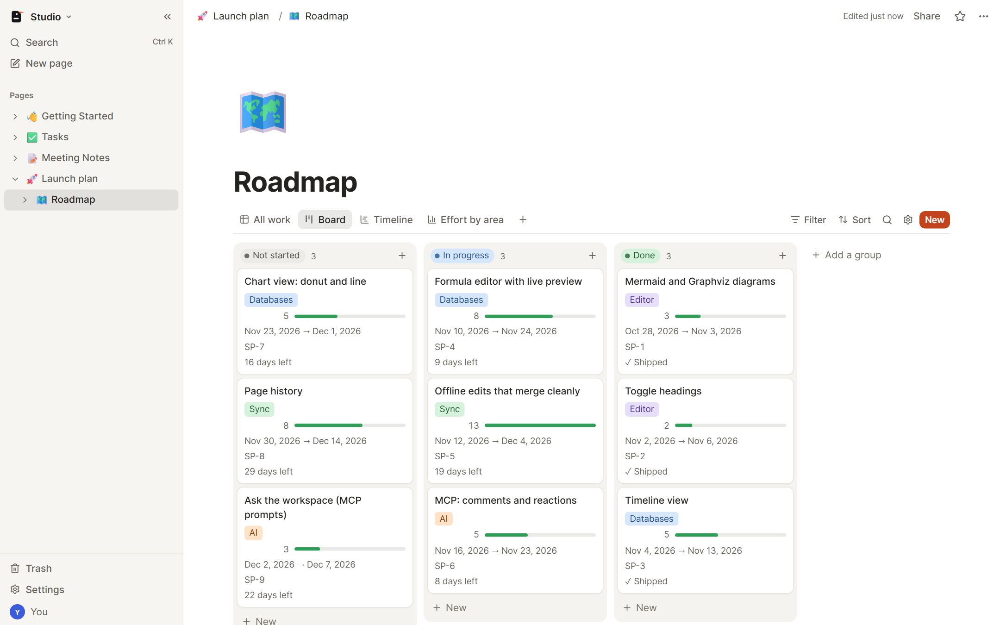
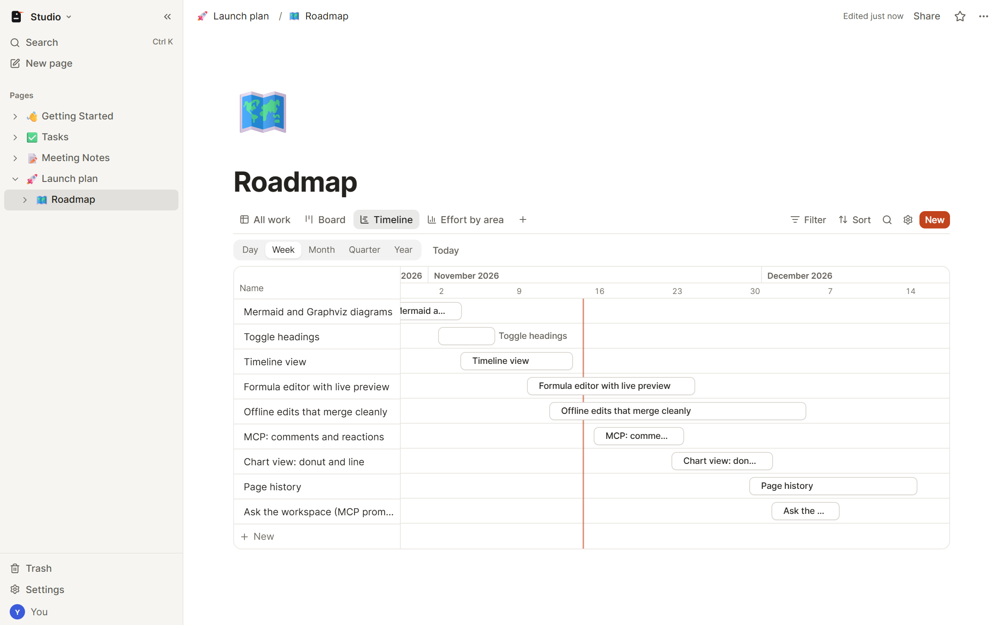
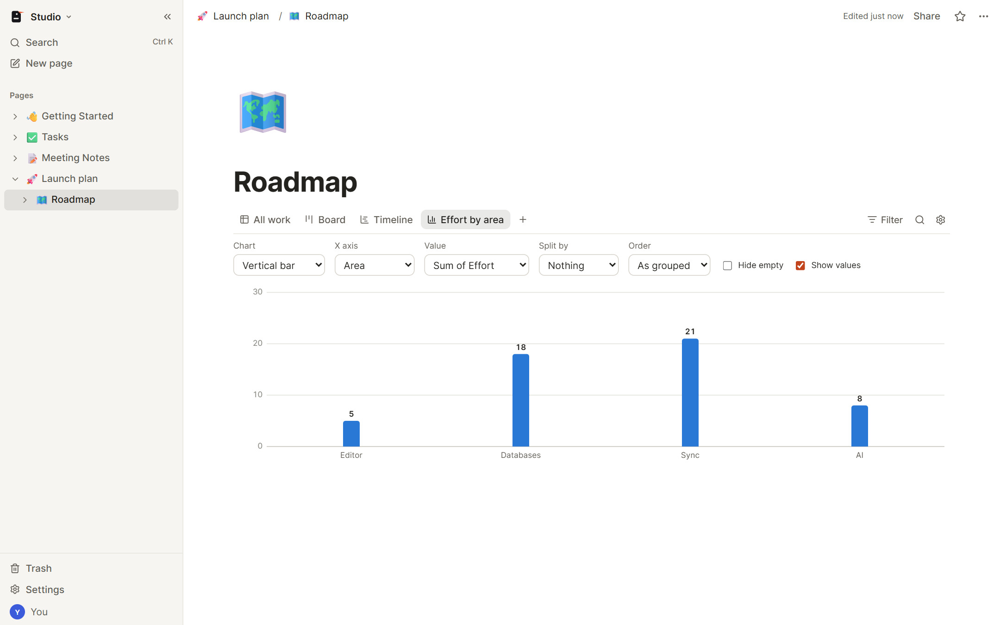
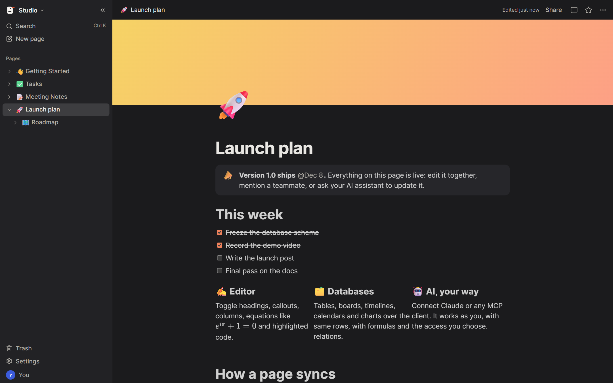
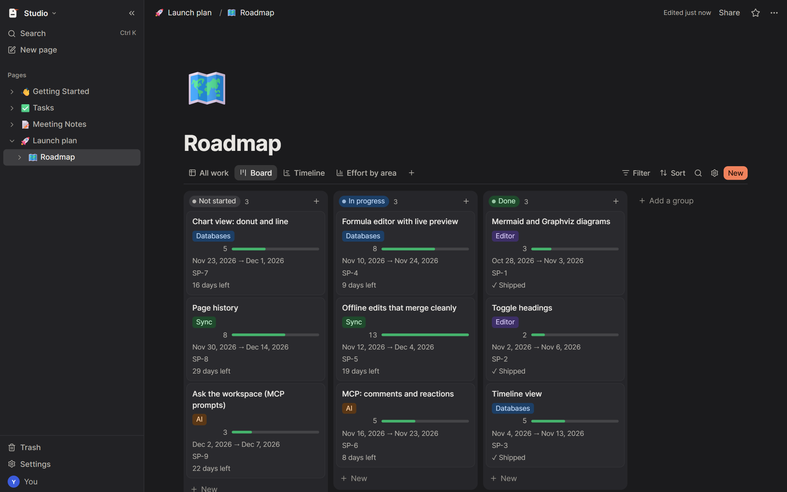
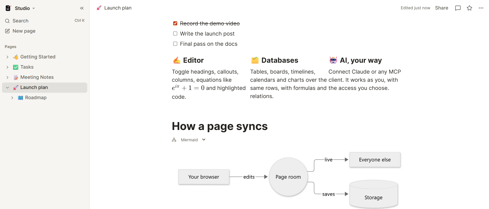
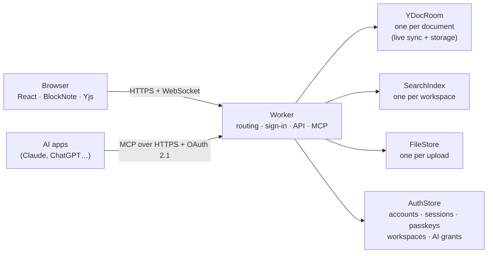

<h1 align="center">
  <picture>
    <source media="(prefers-color-scheme: dark)" srcset="brand/sandpiper-on-dark-horizontal.svg">
    
  </picture>
</h1>

<p align="center">
  <b>The Notion-style workspace you actually own.</b><br>
  Pages, databases and real-time collaboration, self-hosted on your own Cloudflare account,<br>
  free to run, open source, and wired for AI from day one.
</p>

<p align="center">
  <a href="LICENSE"></a>
  <a href="https://workers.cloudflare.com/"></a>
  <a href="#connect-your-ai"></a>
  <a href="tsconfig.json"></a>
</p>

<p align="center">
  <a href="#try-it-in-one-minute"><b>Try it in one minute</b></a> ·
  <a href="#deploy-to-cloudflare"><b>Deploy</b></a> ·
  <a href="#connect-your-ai"><b>Connect your AI</b></a> ·
  <a href="#sandpiper-vs-notion"><b>Sandpiper vs Notion</b></a>
</p>

<picture>
  <source media="(prefers-color-scheme: dark)" srcset="docs/screenshots/editor-dark.png">
  
</picture>

Your notes are the most personal software you use. Sandpiper gives you the editor and databases you'd expect from
Notion (nested pages, a block editor, tables and boards and calendars, formulas, relations, live cursors), but it
runs on infrastructure you control, costs nothing on Cloudflare's free plan, and has no per-seat pricing, no
lock-in and no one else's AI reading your pages. When you *do* want AI, connect your own: Sandpiper is an
[MCP](https://modelcontextprotocol.io) server, so Claude, ChatGPT and other assistants can read and edit your
workspace as you, with the permissions you choose.

<table>
  <tr>
    <td width="50%"></td>
    <td width="50%"></td>
  </tr>
  <tr>
    <td align="center"><sub><b>Table</b> · status, selects, number bars, date ranges, a formula, totals</sub></td>
    <td align="center"><sub><b>Board</b> · the same rows, grouped by status</sub></td>
  </tr>
  <tr>
    <td width="50%"></td>
    <td width="50%"></td>
  </tr>
  <tr>
    <td align="center"><sub><b>Timeline</b> · day to year, with today marked</sub></td>
    <td align="center"><sub><b>Chart</b> · bars, lines and donuts from any grouping</sub></td>
  </tr>
  <tr>
    <td width="50%"></td>
    <td width="50%"></td>
  </tr>
  <tr>
    <td colspan="2" align="center"><sub><b>Dark theme</b> · follows your system, or pick one in Settings</sub></td>
  </tr>
</table>

---

**Contents** ·
[Features](#features) ·
[Sandpiper vs Notion](#sandpiper-vs-notion) ·
[Try it in one minute](#try-it-in-one-minute) ·
[Deploy](#deploy-to-cloudflare) ·
[Connect your AI](#connect-your-ai) ·
[How it works](#how-it-works) ·
[Privacy](#privacy-and-where-your-data-lives) ·
[Contributing](#contributing) ·
[License](#license)

---

## Features

### ✍️ A block editor that keeps up with you
- Headings 1–4 and **toggle headings**, bulleted, numbered and to-do lists, toggles, quotes, dividers, and
  **callouts** in any colour.
- **Code blocks** with syntax highlighting for ~45 languages, in light and dark.
- **Equations**, block and inline, typeset with KaTeX.
- **Diagrams** from text: Mermaid and Graphviz drawn in your browser, PlantUML too. Write them in a diagram block
  or in a code block and flip between Code, Preview and Split.
- **Columns** (2 to 5, resizable), tables with merged cells and colours, images, video, audio and files.
- **Web bookmarks** with title, description and preview image, and **embeds** for YouTube, Google Maps, Figma,
  Loom, Spotify, Google Docs, CodePen, or any page.
- A **table of contents**, a **breadcrumb**, and **links to a single block** that scroll right to it.
- `@` mentions of pages, people and dates, `:` for emoji, `/` for everything, Markdown shortcuts as you type.
- **Turn into** any block type, plus a block menu (and right-click) to duplicate, recolour, copy a link, or move a
  block to another page.
- Text colours and highlights, bold, italic, underline, strikethrough, inline code, links, clear formatting.



### 🗂️ Databases with real depth
- Every page can hold databases, full-page or **inline**, and any database can appear elsewhere as a
  **linked view**.
- Property types: text, number, select, multi-select, **status** (To-do / In progress / Complete), date with ranges
  and times, person, files & media, checkbox, URL, email, phone, **relation** (one- or two-way), **rollup**,
  **formula**, **button**, **unique ID**, created/edited time and by.
- **Formulas** in Notion's formula language: `prop("Price") * prop("Qty")`, `if()`, `ifs()`, `dateBetween()`,
  `formatDate()`, `map()`, `filter()`, `let()` and dozens more, reaching through relations.
- Numbers as plain values, with separators, as percent or in ~45 currencies, with fixed decimals, or drawn as a
  **progress bar or ring**.
- Seven views: **table, board, list, gallery, calendar, timeline and chart**.
- Filters with **and/or groups** and relative dates ("this week", "past month"), multiple sorts, **grouping** in
  every view, and **calculations** under each column: counts, percentages, sum, average, median, min, max, range,
  earliest and latest dates.
- A Notion-style column menu: edit, change type (values convert), filter, sort, group, calculate, **freeze**,
  hide, wrap, insert left/right, duplicate, delete. Drag columns to reorder.
- Every row is a page: open it in a side peek, a centre peek, or full page.

### 👥 Built for doing things together
- **Live everything**: cursors and selections, presence avatars, titles, the page tree, cells and views sync the
  moment they change.
- **Comment threads** on any text, with replies, reactions and resolve.
- **Workspaces** that are private to you or shared with exactly the people you pick.
- Sign in with **Google** or with **passkeys** (fingerprint, face, device PIN). The owner decides who can sign in;
  removing someone signs them out everywhere at once.
- Search across every title and page (Ctrl/Cmd+K), favourites, trash with restore, page locking, templates,
  Markdown import, Markdown and HTML export, light and dark themes, and a layout that works on a phone.

### 🤖 AI on your terms, over MCP
Sandpiper ships an **MCP server** with tools for practically everything you can do in the app: create and
reorganise pages, write and edit content block by block (or in Markdown), tick to-dos, comment, build databases
with formulas and relations, add rows, set any value, configure views, and query databases with formulas, rollups,
groups and calculations worked out for you. Connections use OAuth 2.1 and act **as the person who approved them**,
limited to read-only or to chosen workspaces if they like. [How to connect →](#connect-your-ai)

### ☁️ Self-hosted, and free to run
One Cloudflare Worker and a few SQLite-backed Durable Objects. No servers to patch, no database to back up by
hand, no container to keep alive. A small team will fit comfortably inside Cloudflare's **free plan**.

## Sandpiper vs Notion

|  | **Sandpiper** | **Notion** |
|---|---|---|
| Where your data lives | Your own Cloudflare account | Notion's servers |
| Price | Free on Cloudflare's free plan | Per seat, per month |
| Source code | Open (AGPL-3.0) | Closed |
| Block editor, nested pages, live collaboration | ✅ | ✅ |
| Databases: table, board, list, gallery, calendar, timeline, chart | ✅ | ✅ |
| Formulas, relations, rollups, status, buttons, IDs | ✅ | ✅ |
| Equations, Mermaid diagrams, code highlighting | ✅ (+ Graphviz, PlantUML) | ✅ (Mermaid) |
| Comments, mentions, passkeys | ✅ | ✅ |
| AI | Bring your own, over MCP | Notion AI (paid add-on) |
| Built-in AI writing and AI autofill | ❌ | ✅ |
| Synced blocks | ❌ | ✅ |
| Forms | ❌ | ✅ |
| Page version history | ❌ | ✅ |
| Reminders and notifications | ❌ | ✅ |
| Per-page permissions and public sharing | ❌ (workspace-level members) | ✅ |
| Automations, map view | ❌ | ✅ |

Sandpiper is young and opinionated: it covers the everyday 90% superbly and says plainly what it doesn't do yet.

## Try it in one minute

You need [Node.js](https://nodejs.org) 20 or newer.

```bash
git clone https://github.com/denxxs/sandpiper.git
cd sandpiper
npm install
npm run dev:demo
```

Open **http://localhost:5199** and click **Continue with Google**. In demo mode a local stand-in signs you straight
in as `you@example.com` (the owner listed in `wrangler.jsonc`), so you don't need a Google account or OAuth client.
The stand-in works only in local development; deployed copies ignore it.

Everything runs locally: Wrangler emulates the Worker and its Durable Objects, and your data lands in
`.wrangler/state/` (delete that folder to start over). To develop against real Google sign-in instead, follow the
Google steps below, put `GOOGLE_CLIENT_SECRET=…` in a `.dev.vars` file (git-ignored), and run `npm run dev`.

## Deploy to Cloudflare

**1. Sign in to Cloudflare.** A free account is enough.

```bash
npx wrangler login
```

**2. Choose who can sign in first.** In `wrangler.jsonc`, set `INITIAL_MEMBERS` to your email as the owner, and
anyone else as members:

```jsonc
"INITIAL_MEMBERS": "you@example.com:owner,alex@example.com:member"
```

It's read only the first time Sandpiper starts; after that, the owner manages people in **Settings → App → Who can sign in**.

**3. Deploy.**

```bash
npm run deploy
```

Sandpiper is now live at `https://sandpiper.<your-subdomain>.workers.dev`. Deploying again later never touches
your data.

**4. (Optional) Use your own domain.** Add the domain to your Cloudflare account, then in `wrangler.jsonc` add
`"routes": [{ "pattern": "notes.example.com", "custom_domain": true }]`, set `"workers_dev": false`, and deploy
again. Do this before you add passkeys: a passkey belongs to the address it was made on.

**5. Set up Google sign-in.**

1. In the [Google Cloud console](https://console.cloud.google.com), create a project.
2. Open **Google Auth Platform → Get started**: any app name, your email as support contact, audience
   **External**. Under **Audience**, **Publish app** (sign-in asks only for name, email and photo, which need no
   review), or stay in Testing and add your members as test users. Either way, only people on Sandpiper's member
   list get in.
3. Under **Clients**, create a **Web application** client with these **Authorised redirect URIs**:
   - `https://<your-address>/auth/google/callback`
   - `http://localhost:5199/auth/google/callback` (for local development)
4. Put the **Client ID** in `wrangler.jsonc` as `GOOGLE_CLIENT_ID` (it isn't secret), and store the **Client
   secret** with Cloudflare:

   ```bash
   npx wrangler secret put GOOGLE_CLIENT_SECRET
   ```

5. Deploy once more: `npm run deploy`.

Sign in with Google, then add a passkey in **Settings → Sign-in & devices** for one-tap sign-in on each device.

## Connect your AI

Your MCP server lives at **`https://<your-address>/mcp`**. **Settings → AI & apps** shows the exact address, every
connected app, and lets you create access tokens.

- **Claude** (web and desktop): Settings → Connectors → *Add custom connector*, paste the address, Connect.
- **Claude Code**:
  ```bash
  claude mcp add --transport http sandpiper https://<your-address>/mcp
  ```
  then run `/mcp` inside Claude Code to sign in.
- **ChatGPT and other MCP clients**: paste the address wherever they take a remote MCP server.
- **Scripts and apps that want a token**: create one in Settings → AI & apps and send it as
  `Authorization: Bearer sp_pat_…`.

Connecting opens an approval page where you choose **what** the app can do (read only, or read and edit) and
**where** (all your workspaces, or only some). The app acts as you, can do exactly what you can and nothing more,
and you can disconnect it at any time. Locked pages stay locked. Account security (who can sign in, passkeys,
sessions, the connections themselves) is deliberately out of AI's reach.

## How it works



- **Every document is a [Yjs](https://yjs.dev) CRDT** in its own Durable Object: a workspace's page tree (pages,
  databases, rows, properties, views) is one document, and each page's content is another. Browsers sync over
  WebSockets, so edits merge without conflicts and keep working through a flaky connection.
- **The editor is [BlockNote](https://www.blocknotejs.org)** with Sandpiper's own blocks (callouts, equations,
  diagrams, columns, bookmarks, embeds, databases…) defined once in `shared/blocks.ts`.
- **Database logic is shared code.** `shared/db.ts` (values, formats, filters, sorts, grouping, calculations,
  relations, rollups) and `shared/formula.ts` (the formula language) run in the browser *and* on the server, so an
  AI asking for a filtered, grouped view gets exactly what you see.
- **The MCP server** (`worker/mcp/`) speaks MCP's Streamable HTTP transport, with OAuth 2.1 (dynamic client
  registration, client metadata documents, PKCE, rotating refresh tokens) in `worker/oauth.ts`. Each change runs
  inside the document's own Durable Object, on a copy first so it applies all or nothing, through a headless
  BlockNote editor with the app's schema, so it writes exactly what the app's editor would. Changes appear live
  for anyone with the page open.

### Project layout

```
src/                     the web app (React 19, Vite)
  App.tsx, main.tsx        app shell
  store.ts, nav.ts         workspace state and mutations; routing (workspace in the path, page in the hash)
  components/              sidebar, pages, editor, settings, sign-in, approval page
  components/db/           database values and editors, column menu, filters/sorts/settings, views,
                           timeline, chart
  components/blocks.tsx    the editor's extra blocks; editorUi.tsx its menus; codeBlock.ts code blocks
  render.ts                equations (KaTeX) and diagrams (Mermaid, Graphviz; PlantUML via the server)
shared/                  code the app and the server both run
  db.ts, formula.ts        databases as data, and the formula language
  blocks.ts                the editor's custom blocks
worker/                  the Cloudflare Worker
  index.ts                 Durable Objects: document rooms, search, files
  app.ts                   routing: sign-in, account and workspace API, documents, uploads, search
  auth.ts                  AuthStore: accounts, sessions, passkeys, people, workspaces, AI grants and tokens
  oauth.ts                 OAuth 2.1 for AI apps
  rooms.ts                 which workspace a room, search index or file belongs to
  mcp/                     the MCP server: tools, page tree and content operations, Markdown in and out
scripts/dev-signin.mjs   the local stand-in for Google used by `npm run dev:demo`
wrangler.jsonc           Cloudflare configuration
DESIGN.md                the design system
brand/                   the logo, icons and brand guide
docs/screenshots/        the pictures in this README
```

## Privacy and where your data lives

- Each document (a workspace's page tree, and each page) is stored in its own Durable Object in **your** Cloudflare
  account. Uploaded files are stored the same way, one object per file, and can only be opened by members of
  their workspace.
- Accounts, sessions, passkeys, workspaces and AI connections live in one more object. Session cookies are
  HttpOnly; only hashes of sessions and tokens are stored.
- The server checks every live connection, upload, file, search and copy against the workspace's member list.
- Things that leave your account, and when:
  - **PlantUML diagrams** are drawn by plantuml.com's public server, which sees the diagram's text (PlantUML
    needs Java, which Cloudflare can't run). Mermaid and Graphviz diagrams and equations are drawn in your
    browser.
  - A **bookmark's** title, description and image are fetched by your Sandpiper server from the linked page.
  - **Embeds** load the provider's page (YouTube, Maps…) in your browser, as any embedded page does.
  - **Google sign-in** talks to Google; passkeys don't.
- Deleting a workspace deletes its documents and search index. There's no whole-workspace export yet; pages export
  to Markdown or HTML from the page menu.

## Free-plan limits

| Limit (per day unless noted) | Free allowance | What uses it |
|---|---|---|
| Requests | 100,000 | page loads; live-sync messages count at 1/20th each |
| Storage rows written | 100,000 | roughly one or two per edit |
| Stored data (total) | 5 GB | notes and uploaded files |
| Upload size | 25 MB per file | set in the app |

A household or a small team won't come close in normal use. If a daily limit is ever hit, edits pause until
midnight UTC; Cloudflare's Workers Paid plan removes the caps.

## Limitations

- Everyone in a workspace can read and edit everything in it; there are no per-page permissions or public pages.
- Pages can't move between workspaces yet, and nest up to 8 levels deep.
- Database filters, sorts and view settings are shared by everyone, not per person.
- Not built yet: built-in AI writing, synced blocks, forms, automations, map views, reminders and notifications,
  page version history.

## Contributing

Issues and pull requests are welcome. Run `npm run dev:demo` for a local copy, and `npm run typecheck` before you
send a change. Keep the app and the MCP server in step: a feature people can use in the app should be reachable
through an MCP tool too (`worker/mcp/tools.ts`), and anything both sides compute belongs in `shared/`. UI changes
should follow [DESIGN.md](DESIGN.md).

By contributing, you agree that your contributions are licensed under the same license as the project
(AGPL-3.0-only).

## License

Sandpiper is © 2026 Dennis Sagayanathan, released under the **GNU Affero General Public License v3.0 only**
([LICENSE](LICENSE)). You may use, study, modify and share it. If you run a modified version as a service that
others use over a network, the AGPL requires you to offer those users the source code of your version.

The Sandpiper name and logo aren't covered by the AGPL: use them to talk about Sandpiper, and give a modified
version you run for others its own name and logo. The brand files and usage guide are in [brand/](brand/README.md).

*Notion is a trademark of Notion Labs, Inc. Sandpiper is an independent project, not affiliated with or endorsed
by Notion Labs.*
